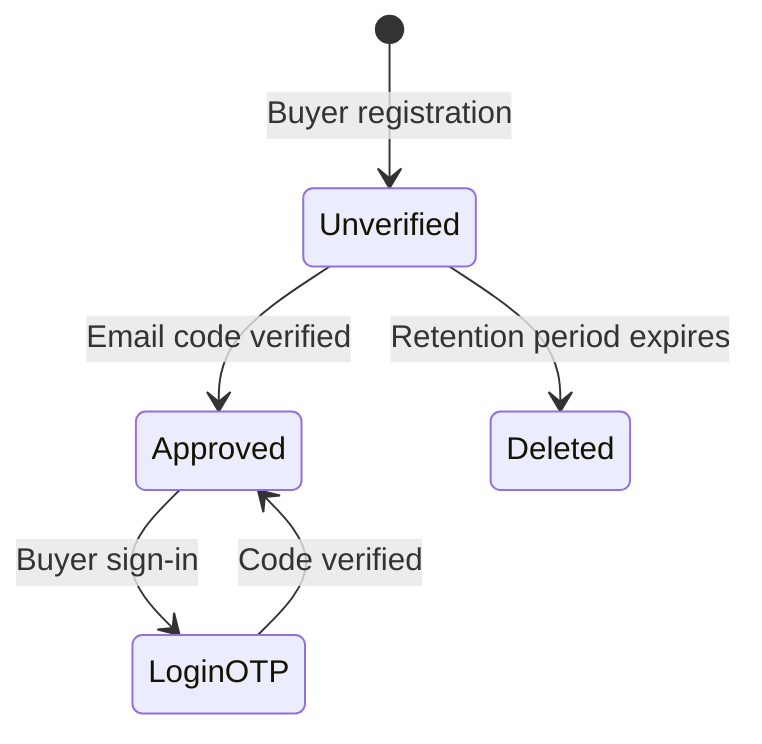
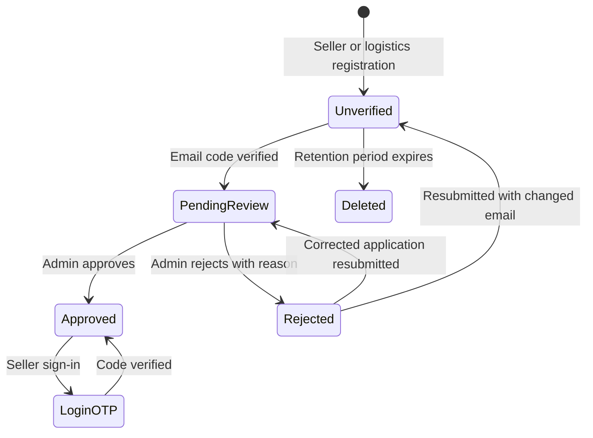
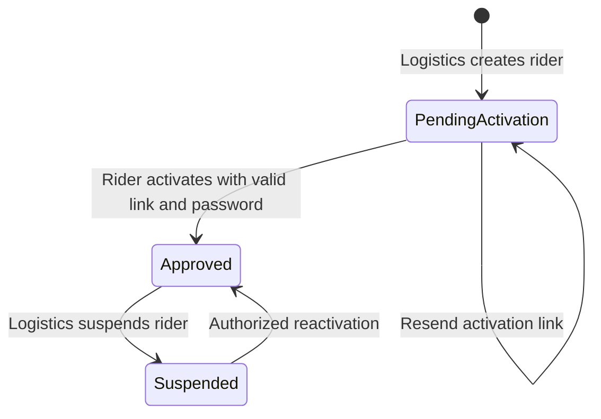

# Registration and Login Overhaul Implementation Notes

This note records the implemented audit items and decisions taken against the audit documents and the black-box workbook. The workbook remains unchanged; its Actual Result, Status, and Remarks cells were not edited. See [registration-login-test-traceability.md](registration-login-test-traceability.md) for all 150 case IDs and current verification labels.

## Delivered changes

- Registration and sign-in normalize email and Philippine mobile numbers, validate RFC-style email syntax, enforce unique normalized identity and business identifiers, and apply consistent name rules.
- Registration requires an adult birth date and a password of 8–128 characters with upper and lower case letters, a number, and a symbol. The same password policy applies to account password changes and rider activation.
- Buyer, seller, and logistics accounts receive a hashed, five-minute email verification code with a five-attempt limit and resend cooldown. Failed mail dispatch now leaves no unusable challenge record and presents a retry message. Buyer and seller sign-ins also require an email code, as requested earlier in this conversation.
- Email verification pages use session state instead of putting the address in the URL. Seller and logistics location selection is validated against PSGC codes; buyer delivery address remains optional.
- Seller category values come from one server-side list. Policy acceptance records a version and links to the Terms and Privacy pages.
- Seller applications require exactly a valid ID and business permit for every seller type; those two files may be retained during resubmission if already on file.
- Canonical unique columns protect normalized shop, TIN, SEC registration, rider license, and plate values. The migration checks for existing canonical duplicates before backfill and fails with the affected user IDs if cleanup is needed.
- Rejected seller/logistics applicants can retain existing files when resubmitting. Changed email addresses return to email verification before the application goes back into review.
- Rider activation links show an actionable expired/invalid state. Mail failure is reported accurately, activation can be resent, and there is no separate logistics approve/reject rider workflow.
- A scheduled command removes stale unverified buyer, seller, and logistics registrations after the configured retention period and deletes their unreferenced private files. Demo seeding is restricted to local/testing and no longer uses the shared weak demo password.
- Application timezone and registration/hash/rate-limit settings are configurable through environment variables documented in `.env.example`.

## Account state flows

## Discrepancies and decisions

| Source discrepancy | Decision |
|---|---|
| Workbook cases TC-BUY-029 and TC-SEL-040 proceed directly to the dashboard after email verification/admin approval, while the user explicitly requested OTP on every buyer and seller login earlier in this conversation. | Preserve the requested buyer/seller login OTP. Those two workbook expectations are intentionally superseded by the user's earlier requirement. |
| Buyer black-box case TC-BUY-004 says names must contain only letters, while the overhaul audit allows spaces, apostrophes, periods, and hyphens for real names. | Allow letters/marks and common name punctuation; reject digits and other symbols. |
| Rider license prose describes one letter plus eleven digits, while the provided license examples contain ten digits after the letter. | Follow the repeated example format (`N01-23-456789`) and enforce it consistently. |
| Some old feature tests submitted free-form seller/logistics addresses, while the audit requires validated service-area values. | Restrict seller/logistics registration to selected PSGC locations and update focused test fixtures to use PSGC codes. |
| Existing rider review endpoints conflicted with the onboarding flow where account activation sets the rider up directly. | Remove separate approve/reject routes, UI actions, and controller methods. Keep suspension/reactivation controls for active riders. |
| The workbook expects seller documents to vary by seller type, including SEC/BIR/DTI documents. | The user's latest request supersedes those document requirements: all seller types now submit a valid ID and business permit only. |
| Policy pages need organization-specific terms, retention disclosures, and contact details beyond the implementation audit. | Add linked versioned draft pages; have the organization review and approve their exact legal text before production use. |

## Deployment and verification notes

- Apply the new canonical-identifier migration after checking its preflight error for any duplicate legacy records. Resolve duplicates deliberately, then rerun the migration.
- Set the production mail transport and credentials in the deployment environment, clear cached configuration after changing them, and verify registration and login-code delivery through the real SMTP provider. No credential values are included in this repository note.
- The scheduled cleanup command is `accounts:prune-unverified`; Laravel's scheduler must run in each production environment for retention cleanup to occur.
- PHP upload limits must allow the intended document sizes. The registration validators accept up to 5 MB per file; configure PHP/web-server request limits to permit the full multi-file request.
- The generated local demo password is printed once by the local seeder. Store that value securely if it is needed; do not use seeded demo accounts in production.
- Automated results and browser/workbook manual execution status are recorded separately in the traceability document. A passing Laravel test is not a claim that all manual workbook steps have been executed.
